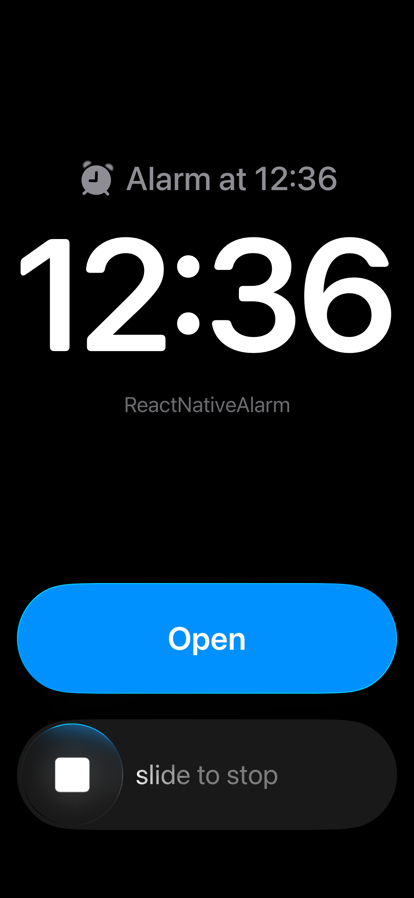
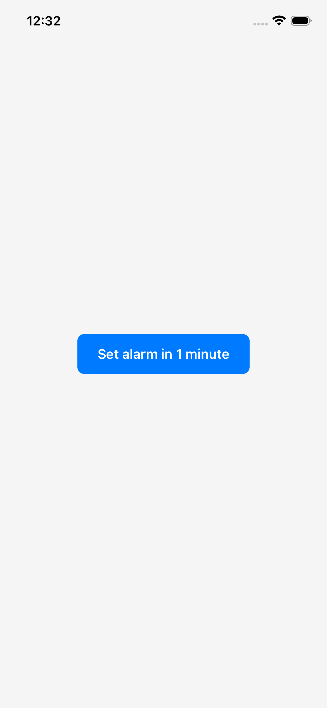
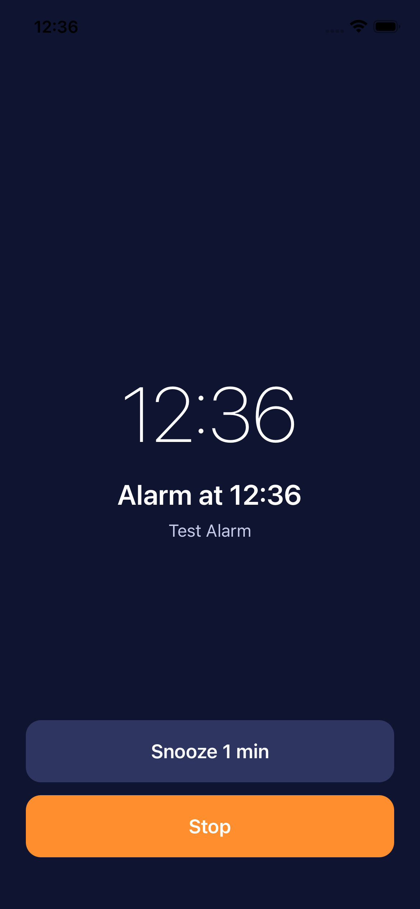

# React Native Alarms 🔔


A cross-platform native scheduling, reminder, and wake-up system for React Native. Schedule time-sensitive events on Android and iOS, deliver reminders, and present a registered custom React Native screen when a scheduled event fires—using one unified API.

Although it can power a traditional alarm clock, react-native-alarms is also useful for exact-time reminders, scheduled check-ins, custom lock-screen experiences, and time-based app workflows. Build the experience around your own UI and event data instead of being limited to a standard alarm screen.

> **Platform note:** The operating system controls background delivery and screen presentation. Exact timing, full-screen presentation, and behavior when an app is terminated depend on platform version, permissions, device settings, and the native scheduling mechanism. This library does not provide unrestricted background JavaScript execution.


[](https://badge.fury.io/js/react-native-alarms)
[](https://opensource.org/licenses/MIT)

## Features

✨ **Cross-Platform Support**
- Seamless support for both Android and iOS
- Native alarm implementation for reliable delivery
- Background execution support

🎯 **Comprehensive Alarm Management**
- Schedule one-time and recurring alarms (daily, weekly, interval-based)
- Update and cancel alarms
- Snooze and stop currently ringing alarms
- Query alarm status

🔔 **Event-Driven Architecture**
- Real-time events for alarm firing, dismissal, and snoozing
- Easy event listener registration and cleanup
- Full-screen alarm display on iOS 26+ with AlarmKit
- Fallback to notifications on older devices

🔐 **Permission Handling**
- Automatic permission checking and requesting
- Platform-specific permission management
- Detailed permission status reporting

## Installation

```bash
npm install react-native-alarms
# or
yarn add react-native-alarms
```

### Native Module Linking

For a bare React Native app, install the iOS pods and rebuild:

```bash
cd ios && pod install && cd ..
```

For Android, the native code auto-links, including the permissions, ring activity,
service and receivers in its manifest. No `MainApplication` or `AndroidManifest.xml`
changes are needed. Rebuild the app after installing.

### Expo

The library works with Expo projects that generate and build native projects
(prebuild, EAS Build, or a development build). It uses React Native autolinking and
does not require an Expo config plugin:

```bash
npm install react-native-alarms
npx expo prebuild
npx expo run:android
# or
npx expo run:ios
```

Rebuild the native app after installing or upgrading the library. **Expo Go is not
supported** because it cannot load this library's native alarm module. Existing bare
React Native installation and setup remain unchanged.
Register the `AlarmRing` component in your app's JavaScript entry point as described
below; Expo Router apps should do this from a custom entry point before loading
`expo-router/entry`.

### Register the ring screen

When an alarm rings, both platforms show a full-screen React component registered as
`AlarmRing`, with the alarm (`alarmId`, `title`, `body`, `snoozeEnabled`,
`snoozeMinutes`, `data`, and optional `image`) as props. Register your own component in `index.js`:

```js
import { AppRegistry } from 'react-native';
import { AlarmRingScreen } from './src/AlarmRingScreen';

AppRegistry.registerComponent('AlarmRing', () => AlarmRingScreen);
```

Call `Alarm.stopAlarm(alarmId)` or `Alarm.snoozeAlarm(alarmId, minutes)` from its
buttons; the screen closes itself.

#### Custom presentation component

You can register **multiple** ring screens and choose which one fires per alarm using the `presentation` field in `AlarmConfig`:

```js
// index.js
import { AppRegistry } from 'react-native';
import { AlarmRingScreen } from './src/AlarmRingScreen';
import { ReminderScreen } from './src/ReminderScreen';

AppRegistry.registerComponent('AlarmRing', () => AlarmRingScreen);   // default
AppRegistry.registerComponent('Reminder', () => ReminderScreen);     // custom
```

```ts
import { AlarmRegistry, AlarmService } from 'react-native-alarms/service';

// 1. Map your key to the registered component name
AlarmRegistry.register('reminder', 'Reminder');

// 2. Pass it when scheduling
await AlarmService.scheduleAlarm({
  timestamp: Date.now() + 60_000,
  title: 'Standup',
  presentation: {
    type: 'reminder',           // resolves to the 'Reminder' component
    props: { color: '#6200EE' } // forwarded to the screen as componentProps
  },
});
```

The native layer maps `presentation` to two internal fields:

| Internal field | Type | Default | Description |
|---|---|---|---|
| `componentName` | `string` | `"AlarmRing"` | Registered `AppRegistry` component name shown when the alarm rings. |
| `componentProps` / `componentPropsJSON` | `object` / `string` | `{}` | Key-value props forwarded to the ring screen on **both platforms**. On Android they arrive as top-level bundle extras and a nested `componentProps` map; on iOS as a parsed `[String: Any]` dictionary. |

### Direct module access

```ts
import Alarm, { AlarmService } from 'react-native-alarms';

const id = await Alarm.scheduleAlarm({ timestamp: Date.now() + 60_000, title: 'Wake up' });
```

## Quick Start

### Basic Usage

```typescript
import { AlarmService } from 'react-native-alarms/service';

// Check permissions
const permission = await AlarmService.checkPermission();

// Request permissions if needed
if (permission.status !== 'granted') {
  await AlarmService.requestPermission();
}

// Schedule an alarm for 10 minutes from now
const alarmId = await AlarmService.scheduleAlarm({
  timestamp: Date.now() + 10 * 60 * 1000,
  title: 'Wake up!',
  body: 'Time to start your day',
  vibrate: true,
  snoozeEnabled: true,
  snoozeMinutes: 5,
});

console.log('Alarm scheduled:', alarmId);
```

### Listening to Alarm Events

```typescript
import { AlarmService } from 'react-native-alarms/service';

// Listen for when alarm fires
const unsubscribeFired = AlarmService.onAlarmFired((alarm) => {
  console.log('Alarm fired:', alarm.title);
});

// Listen for when alarm is dismissed
const unsubscribeDismissed = AlarmService.onAlarmDismissed((alarm) => {
  console.log('Alarm dismissed:', alarm.alarmId);
});

// Listen for when alarm is snoozed
const unsubscribeSnoozed = AlarmService.onAlarmSnoozed((alarm) => {
  console.log('Alarm snoozed:', alarm.alarmId);
});

// Cleanup listeners when done
unsubscribeFired();
unsubscribeDismissed();
unsubscribeSnoozed();
```

### Managing Alarms

```typescript
import { AlarmService } from 'react-native-alarms/service';

// Get all scheduled alarms
const alarms = await AlarmService.getAllAlarms();

// Get a specific alarm
const alarm = await AlarmService.getAlarm(alarmId);

// Check if alarm is scheduled
const isScheduled = await AlarmService.isScheduled(alarmId);

// Update an alarm
await AlarmService.updateAlarm(alarmId, {
  timestamp: Date.now() + 20 * 60 * 1000,
  title: 'Updated alarm',
});

// Snooze the currently ringing alarm
await AlarmService.snoozeAlarm(alarmId, 10); // Snooze for 10 minutes

// Stop the currently ringing alarm
await AlarmService.stopAlarm(alarmId);

// Cancel a specific alarm
await AlarmService.cancelAlarm(alarmId);

// Cancel all alarms
await AlarmService.cancelAllAlarms();
```

## API Reference

### Types

#### `AlarmConfig`
Configuration object for scheduling alarms.

```typescript
type AlarmConfig = {
  alarmId?: string;           // Unique identifier (auto-generated if omitted)
  timestamp: number;          // Time in milliseconds (Date.now() format)
  title: string;              // Alarm title/label
  body?: string;              // Alarm description
  image?: string;             // file:// or https:// image URI for ring screen/notifications
  sound?: string;             // 'default' or custom sound file name
  vibrate?: boolean;          // Enable vibration (Android only)
  snoozeEnabled?: boolean;    // Allow snoozing
  snoozeMinutes?: number;     // Snooze duration in minutes
  repeat?: AlarmRepeat;       // Repeat configuration
  data?: string;              // Custom JSON string payload
  presentation?: AlarmPresentation; // Custom ring screen & props
};

type AlarmPresentation = {
  /** Registered presentation type (key passed to AlarmRegistry.register). */
  type?: string;
  /**
   * Props forwarded to the ring screen component.
   * Available as `componentProps` on both Android and iOS.
   */
  props?: Record<string, unknown>;
};
```

Pass a URI string for `image`; for example:

```ts
await AlarmService.scheduleAlarm({
  timestamp: Date.now() + 60_000,
  title: 'Appointment',
  image: 'https://example.com/appointment.jpg',
});
```

When provided, `image` is returned with queried alarms and alarm events, passed to
the registered ring screen as an initial prop, and used for the native notification
image where supported. Android accepts `https://`, `file://`, and `content://` URIs.
iOS notification attachments accept `https://` and `file://` URIs; the iOS 26+
AlarmKit system alert itself does not display custom images, but the image URI is
available to the React Native ring screen when it opens. Render it in that screen
with React Native's `Image` component and `source={{ uri: image }}`.

> **How the native layer stores these:** `AlarmConfig.presentation` is resolved by `AlarmService` before being handed off to the native module. The resulting fields stored in the native `AlarmData` model are:
>
> | Field | Type | Default | Description |
> |---|---|---|---|
> | `componentName` | `string` | `"AlarmRing"` | The `AppRegistry` name of the component shown at ring time. Derived from `AlarmRegistry.resolve(presentation.type)`. |
> | `componentProps` | `object` | `{}` | Parsed props object (from `presentation.props`). Available on both platforms at ring time as `componentProps`. |
> | `componentPropsJSON` | `string` | `"{}"` | JSON-serialised representation of `componentProps`, persisted alongside the alarm so props survive a device reboot. |

#### `AlarmRepeat`
Repeat configuration for recurring alarms.

```typescript
type AlarmRepeat = {
  type: 'none' | 'daily' | 'weekly' | 'interval';
  weekdays?: number[];        // 1 = Sunday, 7 = Saturday (for weekly)
  intervalMs?: number;        // Interval in milliseconds (for interval type)
};
```

#### `Alarm`
Alarm object returned from queries.

```typescript
type Alarm = {
  alarmId: string;
  timestamp: number;
  title: string;
  body: string;
  image?: string;
  sound: string;
  vibrate: boolean;
  snoozeEnabled: boolean;
  snoozeMinutes: number;
  repeat: AlarmRepeat;
  data: string;
  enabled: boolean;
  nextTriggerAt: number;      // 0 if no future trigger
};
```

#### `AlarmPermission`
Permission status object.

```typescript
type AlarmPermission = {
  status: 'granted' | 'denied' | 'notDetermined';
  notifications: boolean;
  canScheduleExact: boolean;
  canDrawOverlays: boolean;   // Android only
  canUseFullScreenIntent: boolean; // Android only
  backend?: string;           // iOS only: 'alarmkit' or 'notifications'
};
```

## Platform-Specific Behavior

### iOS
- **iOS 26+**: Uses native AlarmKit for real alarms that bypass silent mode
- **iOS < 26**: Falls back to local notifications
- Always handles vibration through system settings
- Full-screen alarm display with system Stop/Snooze buttons

### Android
- Requires `SCHEDULE_EXACT_ALARM` permission for exact timing
- Uses full-screen notifications on lock screen
- Respects silent mode (can be overridden with system settings)
- Supports custom sounds from app bundle or file system

## Repeat Types

### None (One-time)
```typescript
{ type: 'none' }
```

### Daily
Rings at the same time every day.
```typescript
{ type: 'daily' }
```

### Weekly
Rings at the same time on specified days.
```typescript
{
  type: 'weekly',
  weekdays: [1, 3, 5] // Sunday, Wednesday, Friday
}
```

### Interval
Rings at regular intervals. Note: intervals reset if the app is killed.
```typescript
{
  type: 'interval',
  intervalMs: 3600000 // Every hour
}
```

## Building Your Own Alarm UI

The library provides the core alarm management logic. You build your own UI components. Here's a complete example:

```typescript
import React, { useEffect, useState } from 'react';
import { View, Text, TouchableOpacity, StyleSheet } from 'react-native';
import { AlarmService } from 'react-native-alarms/service';

export function AlarmScreen() {
  const [alarms, setAlarms] = useState([]);
  const [permissions, setPermissions] = useState(null);

  useEffect(() => {
    initializeAlarms();
  }, []);

  const initializeAlarms = async () => {
    const perms = await AlarmService.checkPermission();
    setPermissions(perms);

    if (perms.status !== 'granted') {
      await AlarmService.requestPermission();
    }

    const allAlarms = await AlarmService.getAllAlarms();
    setAlarms(allAlarms);

    const unsubFired = AlarmService.onAlarmFired((alarm) => {
      console.log('🔔 Alarm fired:', alarm.title);
    });

    const unsubSnoozed = AlarmService.onAlarmSnoozed((alarm) => {
      console.log('😴 Alarm snoozed:', alarm.title);
    });

    return () => {
      unsubFired();
      unsubSnoozed();
    };
  };

  const scheduleAlarm = async () => {
    const alarmId = await AlarmService.scheduleAlarm({
      timestamp: Date.now() + 5 * 60 * 1000,
      title: 'Time for a break!',
      body: 'Take a moment to rest',
      vibrate: true,
      snoozeEnabled: true,
      snoozeMinutes: 5,
    });

    const updated = await AlarmService.getAllAlarms();
    setAlarms(updated);
  };

  return (
    <View style={styles.container}>
      <Text style={styles.title}>Alarm Manager</Text>
      
      <TouchableOpacity
        style={styles.button}
        onPress={scheduleAlarm}
      >
        <Text style={styles.buttonText}>Schedule Alarm</Text>
      </TouchableOpacity>

      <View style={styles.list}>
        {alarms.map((alarm) => (
          <View key={alarm.alarmId} style={styles.alarmItem}>
            <Text>{alarm.title}</Text>
            <Text>{new Date(alarm.timestamp).toLocaleTimeString()}</Text>
          </View>
        ))}
      </View>
    </View>
  );
}

const styles = StyleSheet.create({
  container: { flex: 1, padding: 20 },
  title: { fontSize: 24, fontWeight: 'bold', marginBottom: 20 },
  button: { backgroundColor: '#007AFF', padding: 12, borderRadius: 8 },
  buttonText: { color: '#fff', fontWeight: 'bold', textAlign: 'center' },
  list: { marginTop: 20 },
  alarmItem: { padding: 12, borderBottomWidth: 1, borderBottomColor: '#eee' },
});
```

## 📸 Screenshots, Demos & Examples

Explore how `react-native-alarms` works on Android and iOS.

### 🖼️ Screenshots

| Sample 1 | Sample 2 | Sample 3 |
|---|---|---|
|  |  |  |

### 🎥 Demo Video

Watch the library in action, including alarm scheduling, ringing, and Stop/Snooze interactions.

[▶️ Watch the React Native Alarms Demo](src/assets/recording.mp4)

## Troubleshooting

### "Alarm Native module is not linked"
Ensure the native module is properly linked:
```bash
cd ios && pod install && cd ..
```

### Alarms not triggering
1. Check permissions: `await AlarmService.checkPermission()`
2. Ensure app has necessary permissions:
   - Android: `SCHEDULE_EXACT_ALARM`, `POST_NOTIFICATIONS`
   - iOS: Allow notifications in Settings

### iOS-specific: Notifications instead of full-screen alarm
- Full-screen alarms (AlarmKit) require iOS 26+
- Older devices use local notifications
- Check `permission.backend` to see which is active

### Android-specific: Alarm doesn't ring when app is killed
- Enable Autostart permissions on device
- Check device's battery optimization settings
- Some OEMs require manual approval in their app management screens

## Contributing

Contributions are welcome! Please feel free to submit a Pull Request.

## License

MIT © 2024 Suraj Prasad

## Support

For issues and questions, please visit:
- GitHub Issues: https://github.com/surajprasad13/react-native-alarms/issues
- Email: surajvishwakarma830@gmail.com

## Changelog

### v0.1.0
- Improved TypeScript support with proper type exports
- Added AlarmService convenience class
- Comprehensive documentation
- Fixed module linking issues

### v0.0.1
- Initial release
- Cross-platform alarm scheduling
- Event-driven architecture
- Permission management

## Custom Alarm UI & Custom Data

The library supports completely custom alarm UI screens with custom data payloads.

### Using `componentName` and `componentProps`

The `presentation` field lets you choose **which registered component** is displayed and pass **arbitrary props** directly to it — without encoding everything inside a JSON `data` string.

#### 1. Register your screens

```js
// index.js
import { AppRegistry } from 'react-native';
import { AlarmRingScreen }   from './src/AlarmRingScreen';
import { MeetingAlarmScreen } from './src/MeetingAlarmScreen';

AppRegistry.registerComponent('AlarmRing',    () => AlarmRingScreen);    // default fallback
AppRegistry.registerComponent('MeetingAlarm', () => MeetingAlarmScreen); // custom
```

#### 2. Map a key to the component name

```ts
import { AlarmRegistry } from 'react-native-alarms';

AlarmRegistry.register('meeting', 'MeetingAlarm');
```

#### 3. Schedule with `presentation`

```typescript
import { AlarmService } from 'react-native-alarms/service';

await AlarmService.scheduleAlarm({
  timestamp: Date.now() + 5 * 60 * 1000,
  title: 'Team standup',
  presentation: {
    type: 'meeting',                    // resolves to 'MeetingAlarm'
    props: {
      roomName: 'Zoom Room A',
      meetingUrl: 'https://zoom.us/j/123',
      accentColor: '#6200EE',
    },
  },
});
```

#### 4. Receive `componentProps` in your screen

The props passed via `presentation.props` are forwarded to the ring screen on both platforms:

```typescript
// MeetingAlarmScreen.tsx
type Props = {
  alarmId: string;
  title: string;
  snoozeEnabled: boolean;
  snoozeMinutes: number;
  data?: string;
  // componentProps fields arrive as top-level props:
  roomName?: string;
  meetingUrl?: string;
  accentColor?: string;
};

export function MeetingAlarmScreen({
  alarmId,
  title,
  snoozeEnabled,
  snoozeMinutes,
  roomName,
  meetingUrl,
  accentColor = '#007AFF',
}: Props) {
  return (
    <View style={{ flex: 1, backgroundColor: accentColor }}>
      <Text style={{ fontSize: 28, color: '#fff' }}>{title}</Text>
      <Text style={{ color: '#fff' }}>{roomName}</Text>

      {snoozeEnabled && (
        <TouchableOpacity onPress={() => AlarmService.snoozeAlarm(alarmId, snoozeMinutes)}>
          <Text>Snooze {snoozeMinutes} min</Text>
        </TouchableOpacity>
      )}
      <TouchableOpacity onPress={() => AlarmService.stopAlarm(alarmId)}>
        <Text>Dismiss</Text>
      </TouchableOpacity>
    </View>
  );
}
```

> **Platform behaviour**
> - **Android**: `componentProps` entries are flattened into the launch `Bundle` alongside standard fields (`alarmId`, `title`, etc.), and also available as a nested `componentProps` bundle. The `AlarmRingActivity` uses `componentName` to resolve which registered React root to display.
> - **iOS**: `componentProps` (parsed from `componentPropsJSON`) is merged into the surface's initial properties passed to the React component.

### Passing Custom Data (legacy approach)

```typescript
await AlarmService.scheduleAlarm({
  timestamp: Date.now() + 5 * 60 * 1000,
  title: 'Important!',
  data: JSON.stringify({
    backgroundColor: '#FF5252',
    priority: 'high',
    customMessage: 'This is urgent!',
  }),
});
```

**Full Guide:** See [CUSTOM_UI_GUIDE.md](./CUSTOM_UI_GUIDE.md) for complete examples and best practices.
